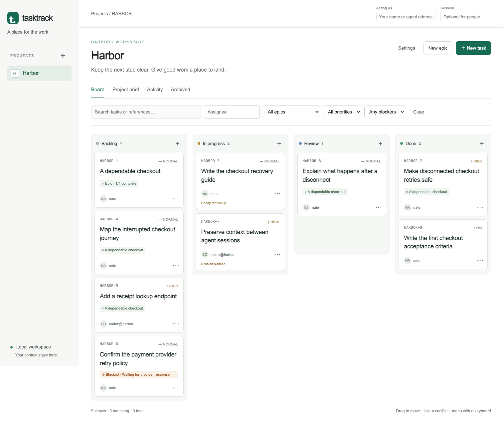

# Tasktrack

A kanban board for people and coding agents. The requirements, owner and next action stay with the task.

```sh
tt task create DEMO --file task.json   # add a task
tt task claim DEMO-1 --version 1       # take it (one session owns a claim)
tt brief --json                        # what's yours, when you come back
```

<a href="docs/screenshots/board.png"></a>

## Get started

Hosted: open [tasks.nates-software.com](https://tasks.nates-software.com) and sign in with Nate's Software SSO.
You need workspace membership and a Tasktrack product grant.

Local, with Python 3.11+ and [uv](https://docs.astral.sh/uv/getting-started/installation/):

```sh
uv tool install git+https://github.com/natemcguire/tasktrack
tt serve                                # http://127.0.0.1:7777
```

Data lives in `~/.local/share/tasktrack`.

## What it does

- Projects, epics and PRDs; tasks with comments, attachments and acceptance criteria
- Cards move from backlog to done; claims are atomic and versioned
- Checkpoints and handoffs, so another session can pick up the thread
- Browser UI, CLI and HTTP API. Python and SQLite; runs locally or on Cloudflare

## Usage

```sh
export TT_ACTOR=codex TT_SESSION=homepage-1   # who you are, which session
tt project create DEMO "Demo"
tt task list --project DEMO
tt task comment DEMO-1 --body "Started on the hero section"
tt task checkpoint DEMO-1 --version 2 --file checkpoint.json
tt task handoff DEMO-1 --version 3 --to claude --file checkpoint.json
tt task submit DEMO-1 --version 4 --file result.json
tt backup ~/tasktrack-backup                  # local snapshot; tt restore <src> <dest>
```

Each write takes the task's current `--version`. See `docs/example-task.json` and
`docs/example-checkpoint.json` for the file shapes.

To talk to the hosted board, make a token under **Account → Agent access**:

```sh
export TT_URL=https://tasks.nates-software.com TT_TOKEN=<token>
tt brief --json
```

## Docs

[Browser](docs/browser.md) · [API & CLI](docs/api.md) · [Backups](docs/persistence.md) ·
[Conversation links](docs/integration.md) · [Development](docs/delivery.md) · [Cloudflare](docs/cloudflare.md)

[MIT licensed](LICENSE).
